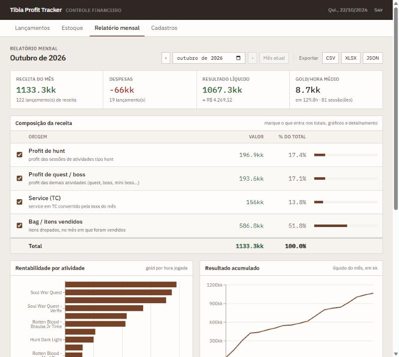
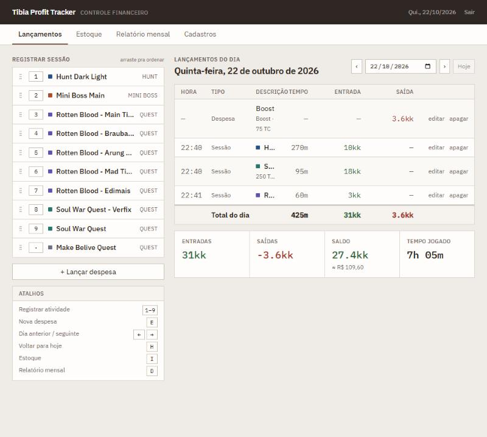
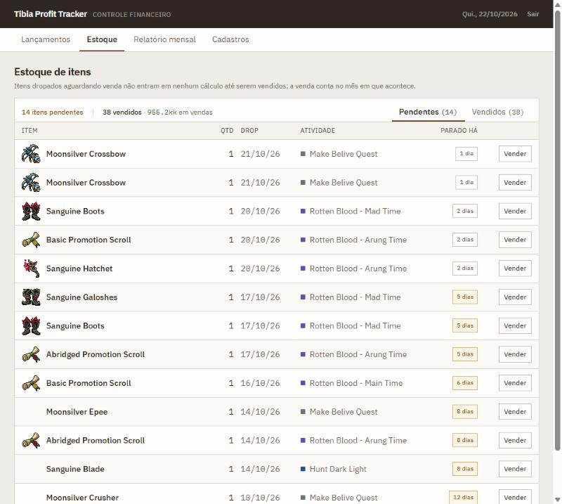

# Tibia Profit Tracker

> Controle financeiro para jogadores de Tibia: registra hunts, quests, service em TC, drops e gastos, e mostra quanto cada atividade realmente rende — em gold e em reais.

**🔗 Demo:** https://tibia-profit-tracker-one.vercel.app *(acesso com login — uso pessoal)*




<table>
  <tr>
    <td></td>
    <td></td>
  </tr>
  <tr>
    <td align="center"><sub>Lançamentos do dia — atalhos e totais</sub></td>
    <td align="center"><sub>Estoque de drops aguardando venda</sub></td>
  </tr>
</table>

## O problema

No Tibia o dinheiro vem de vários lugares ao mesmo tempo — profit de hunt, quests e bosses, service pago em Tibia Coins, itens que caem hoje e só são vendidos semanas depois — e sai em boost, prey e compras. O Hunt Analyser do jogo mostra uma sessão isolada; ele não responde **"o que vale mais a pena eu fazer?"** nem **"quanto eu ganhei esse mês, em reais?"**.

Esse app junta tudo num lugar só e responde essas duas perguntas.

## Funcionalidades

- **Registro rápido de sessões** — grid de atividades com atalhos de teclado (`1`–`9` abre a atividade, `E` lança despesa, `←`/`→` troca o dia, `H` volta pra hoje).
- **Importação do Hunt Analyser** — cola o texto copiado do *Party Hunt Analyser* ou do *Hunt Analyser* solo e o app extrai duração, horário, loot, supplies, balance, divisão por jogador e itens dropados. Mostra uma prévia campo a campo antes de aplicar.
- **Estoque de drops** — item sem preço fica pendente e não infla o lucro; o tempo parado fica destacado. Quando vende (em gold ou TC), o valor entra no mês **da venda**.
- **Duas moedas nativas** — gold e Tibia Coin convivem em todo o app; a conversão pra BRL usa a taxa daquele mês.
- **Relatório mensal** — receita por origem (hunt, quest/boss, service, bag), gastos, líquido em gold e BRL, ranking de **gold/hora por atividade** e profit acumulado.
- **Ícones dos itens** — catálogo com os GIFs do TibiaWiki para os loots de Soul War, Rotten Blood e Make Believe.
- **Exportação** — CSV, XLSX com várias abas e backup completo em JSON.

## Decisões técnicas

**Sem backend próprio.** O frontend fala direto com o Postgres do Supabase via `supabase-js`. Para um app de um usuário isso elimina um servidor inteiro pra manter, e a segurança fica no banco (abaixo), não no código do cliente.

**Segurança no banco, não no frontend.** A anon key do Supabase vai junto no bundle de qualquer site — então ela não pode ser a barreira. O app usa **Supabase Auth** (login com e-mail e senha) e **Row Level Security** em todas as tabelas: só a role `authenticated` lê e escreve. A view de totais usa `security_invoker` para não furar o RLS, e o cadastro público fica desligado. Ver [`006_enable_auth_rls.sql`](supabase/migrations/006_enable_auth_rls.sql).

**Regras de negócio no Postgres.** A taxa TC→gold de cada mês pode ser editada até 7 dias depois do mês fechar; depois disso um **trigger** trava a linha e rejeita qualquer `UPDATE`. Assim o histórico não muda por acidente, mesmo que o frontend tenha um bug. Ver [`004_enforce_rate_lock.sql`](supabase/migrations/004_enforce_rate_lock.sql).

**Histórico congelado.** Cada valor é convertido pela taxa do próprio mês. Mudar a taxa de outubro não altera o resultado de setembro.

**Item conta quando vira dinheiro.** Drops ficam fora da receita até serem vendidos, e entram no mês da venda com a taxa daquele mês — senão um item avaliado "por cima" distorceria o gold/hora.

**Datas no fuso local.** Colunas `date` do Postgres (`"2026-09-01"`) viram meia-noite UTC no `new Date()`, que no Brasil cai em 31/08. As datas são montadas à mão em hora local ([`currency.ts`](src/lib/currency.ts)) para que nenhuma sessão mude de dia ou de mês.

**Bundle enxuto.** O Dashboard (Recharts) e o export XLSX são carregados sob demanda com `lazy()` / `import()`, e React e Supabase ficam em chunks separados para cache.

**Estado do servidor com TanStack Query.** Cache, invalidação após mutations e loading/erro padronizados, sem store global para dados remotos.

## Stack

| Camada | Tecnologia |
|---|---|
| UI | React 19, TypeScript, Tailwind CSS |
| Build | Vite |
| Dados | Supabase (Postgres + Auth + RLS), TanStack Query |
| Gráficos | Recharts |
| Utilidades | react-router, react-hotkeys-hook, zod, date-fns, xlsx, papaparse |
| Deploy | Vercel (deploy automático a cada push na `main`) |

## Rodando localmente

**1. Supabase** — crie um projeto em [supabase.com](https://supabase.com/dashboard) e, no **SQL Editor**, rode as migrations em ordem:

| Migration | O que faz |
|---|---|
| `001_schema.sql` | tabelas, view de totais e trigger da taxa mensal |
| `002_seed.sql` | personagem, atividades e taxa de exemplo (opcional) |
| `003_disable_rls.sql` | histórico — desfeita pela 006 |
| `004_enforce_rate_lock.sql` | trava de verdade a taxa de meses fechados |
| `005_activity_position.sql` | ordem manual das atividades |
| `006_enable_auth_rls.sql` | liga RLS e libera só usuários logados |

Depois, em **Authentication → Users → Add user**, crie seu usuário (marque *Auto confirm*) e, em **Sign In / Providers**, desligue *Allow new users to sign up*.

**2. Variáveis de ambiente**

```bash
cp .env.example .env.local
```

Preencha com a **Project URL** e a **anon key** (Supabase → Settings → API).

**3. Rodar**

```bash
npm install
npm run dev
```

Abre em http://localhost:5173.

## Deploy

Importe o repositório na [Vercel](https://vercel.com/new) (detecta o Vite sozinha), adicione `VITE_SUPABASE_URL` e `VITE_SUPABASE_ANON_KEY` em *Environment Variables* e pronto. O [`vercel.json`](vercel.json) redireciona todas as rotas para o `index.html`, pra que recarregar em `/dashboard` não dê 404.

## Estrutura

```
src/
├── components/     modais, grid de atividades, importação do Hunt Analyser, login
│   └── ui/         Button, Input, Modal, Badge, StatCard
├── pages/          Lançamentos, Estoque, Relatório mensal, Cadastros
├── hooks/          queries e mutations (TanStack Query)
├── lib/            conversão de moeda, relatório, parser do Hunt Analyser, catálogo de itens, export
└── types/          tipos das tabelas
supabase/migrations/  schema, trigger e políticas de acesso
```

## Próximos passos

- Multiusuário: coluna `user_id` em cada tabela e policies por dono
- Filtro por personagem no relatório (o schema já suporta)
- Preços do Bazaar para sugerir valor de venda dos drops
